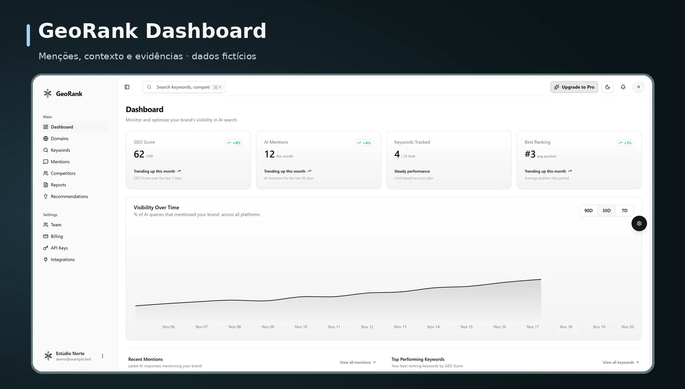

# GeoRank Dashboard

A área autenticada do GeoRank. Ela liga palavras-chave monitoradas às menções encontradas em respostas de IA e aos relatórios usados para acompanhar essas evidências.

Interface real do GeoRank Dashboard com dados fictícios do Estúdio Norte.

[Estudo de caso](https://www.danielneri.pro/pt/work/georank) · [Site e fluxo de entrada](https://github.com/c7bc/georank-frontend-portfolio)

## Do indicador à evidência

1. **Visão geral:** acompanhe o volume de menções e a evolução da visibilidade.
2. **Palavras-chave:** veja o recorte do monitoramento e quais perguntas foram acompanhadas.
3. **Menções:** abra o detalhe para conferir plataforma, consulta e contexto da resposta.
4. **Relatórios:** consulte o registro de resultados por período.

A captura usa respostas locais de teste. Os números representam uma marca fictícia.

## Onde revisar o código

| Área | Arquivos |
| --- | --- |
| Rotas e carregamento por página | [App.tsx](src/App.tsx) |
| Sessão e navegação compartilhada | [AuthenticatedLayout](src/layouts/AuthenticatedLayout.tsx) |
| Menções | [Página](src/pages/MentionsPage.tsx) e [cliente HTTP](src/lib/api/mentions.ts) |
| Cache e atualizações | [Consultas TanStack Query](src/hooks/queries/) e [contexto WebSocket](src/contexts/websocket-context.tsx) |
| Tratamento de respostas da API | [Transporte](src/lib/api/client.ts) e [testes](tests/api-response.test.ts) |

React, TypeScript e Vite sustentam a interface. O React Router controla a navegação, e TanStack Query mantém os dados remotos.

## Executar localmente

Com Node.js 24 e npm:

~~~sh
npm ci
npm run dev
~~~

Abra [localhost:3001/dashboard/](http://localhost:3001/dashboard/). Para acessar as áreas autenticadas, aponte `VITE_API_URL` e `VITE_AUTH_URL` para serviços GeoRank de teste. Os valores padrão ficam em [.env.example](.env.example). Variáveis `VITE_` são públicas no navegador.

~~~sh
npm run check
npm test
npm run build
npm run preview
~~~

Os testes unitários de transporte executam sem a API. A navegação do painel, das palavras-chave e das menções foi verificada em Chromium com respostas fictícias.
